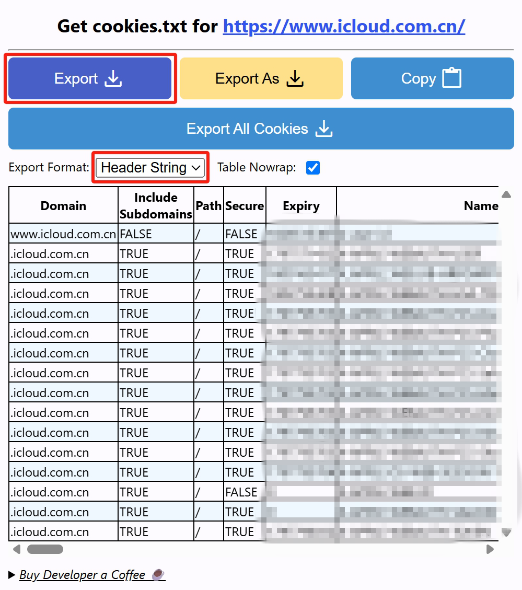

# hidemyemail-generator · Windows 工具包

本目录是 [rtunazzz/hidemyemail-generator](https://github.com/rtunazzz/hidemyemail-generator) 的 Windows 辅助工具包（位于本 fork 的 `contrib/windows/`）。

> ⚠️ 本项目仅用于管理你自己的 iCloud Hide My Email 地址。请遵守 Apple 的服务条款，风险自担。仓库内不包含任何账号数据。

---

## 这个 fork 改了什么

| 位置 | 改动 |
|---|---|
| `src/hidemyemail_generator/main.py` | 修复 `capture-cookie` 在较新 Playwright 下抓不到 Cookie 的问题（改用浏览器上下文重建 Cookie 头）。上游 v2.1.0 仍有此问题 |
| `contrib/windows/` | 本工具包：组模式刷号、归档、批量改标签/备注、IMAP 收件配置、cookie 转换 |

macOS 用法与上游完全一致，见仓库根目录的 README。

---

## 安装方式（二选一）

### 方式 A：EXE 模式（★ 推荐，无需 Python）

适合大多数用户，1 分钟完成：

1. 下载 `hidemyemail-windows.exe`：本 fork 的 [v2.1.0-win Release](https://github.com/VioletYu915/hidemyemail-generator/releases/tag/v2.1.0-win)（镜像自上游 v2.1.0；若文件缺失，`setup.bat` 会自动下载并校验 SHA256）
   `SHA256: D1043F52FC5913B7FEC9E075E9ABE7034626F7BEF56F0E77BC10DB91A6B259DF`
2. 把 exe 放到本目录（`contrib/windows/`）
3. 用浏览器扩展导出 cookie，保存为 `cookies.txt`（见下一节）
4. 双击 **`setup.bat`**，按提示选择 1（EXE）并完成配置
5. 双击 **`start-burst.bat`** 开始

### 方式 B：源码模式（进阶）

适合想用自动抓取 cookie、或想改代码的用户：

1. 安装 [uv](https://astral.sh/uv)
2. 克隆本仓库，或在 `setup.bat` 中让它代跑：
   `uv python install 3.12` + `uv sync --extra capture`
3. 双击 **`setup.bat`**，选择 2（源码），填入源码目录
4. 可用 `capture-cookie` 自动抓取 cookie（EXE 模式没有这个功能）

### 差异对比

| | EXE 模式 | 源码模式 |
|---|---|---|
| 前置依赖 | 无 | uv + Python 3.12 + 依赖 |
| cookie 获取 | 手动（扩展导出） | 自动抓取或手动 |
| 每次调用开销 | 多 1–3 秒（进程启动） | 较快 |
| 升级 | 替换 exe | `git pull` + `uv sync` |
| 适合 | 快速上手、日常使用 | 开发、自动抓 cookie |

### EXE 版本兼容性（v2.1.0）

上游发布的 v2.1.0 EXE 与源码 main 分支存在能力差异，工具包会**自动探测并降级**：

| 能力 | 源码（main） | EXE v2.1.0 | 工具包行为 |
|---|---|---|---|
| `batch` 批次记账 | ✅ | ❌ | 自动降级为本地状态文件，`-Resume` 仍可用 |
| `quota` 配额查询 | ✅ | ❌ | 不依赖该命令 |
| `inbox` 子命令 `--result-json` | ✅ | ❌ | 自动解析命令输出；对账改用导出 CSV |
| `update-metadata --db-file` | ✅ | ❌ | 省略该参数（改动在下次归档时同步到本地库） |
| `generate --batch-id` | ✅ | ❌ | 仅在支持时传入 |
| `capture-cookie` | ✅ | ❌（预编译版禁用） | EXE 模式改用浏览器扩展 |

> 结论：EXE 模式功能完整可用；只有"批次精确归属"和"自动抓 cookie"两项不如源码模式。

---

## 工具包文件说明

| 文件 | 作用 |
|---|---|
| `README.md` | 本文档：安装、cookie、用法、限速原理、FAQ |
| `config.example.json` | 配置模板；`setup.bat` 会据此生成 `config.json` |
| `hme-common.ps1` | 共享函数：双模式运行、能力探测降级、读取本地地址 |
| `setup.ps1` | 首次配置向导（选模式、验证 cookie、写入 config.json） |
| `setup.bat` | 双击入口 → `setup.ps1` |
| `burst-gen.ps1` | 刷号驱动：组 / 间隔 / 连发三种模式、限速冷却、网络重试 |
| `start-burst.bat` | 双击入口 → `burst-gen.ps1` |
| `stop-burst.ps1` | 停止刷号：整树终止进程，并显示当前批次（可 `-Resume`） |
| `stop-burst.bat` | 双击入口 → `stop-burst.ps1` |
| `sync.ps1` | 归档：云端入库 → 收件同步 → 删除对账 → 导出 CSV |
| `archive.bat` | 双击入口 → `sync.ps1` |
| `retag.ps1` | 批量改标签/备注（Excel CSV 模板；留空=保持，`-`=清空） |
| `retag.bat` | 双击入口 → `retag.ps1` |
| `setup-inbox.ps1` | 配置 IMAP 收件（用于提取验证码） |
| `setup-inbox.bat` | 双击入口 → `setup-inbox.ps1` |
| `convert-cookies.ps1` | 把 Netscape 格式 cookie 转成 header / BASE64 |
| `extensions/` | 浏览器扩展安装包（Get cookies.txt LOCALLY v0.7.2，Chrome/Firefox） |

> `config.json`、`cookies.txt`、`inbox_config.json`、`hidemyemail-windows.exe`（首次向导自动下载）、`*.db`、`logs/`、`exports/` 均为运行时生成，已被 `.gitignore` 忽略。

---

## 获取 cookies.txt

### 推荐：浏览器扩展导出 Header string（两种模式都可用）

使用 **Get cookies.txt LOCALLY v0.7.2**（开源、本地处理、不上传）。`extensions/` 子目录已附带安装包：

- Chrome / Edge：`extensions/get-cookies.txt-locally_v0.7.2_chrome.zip`
- Firefox：`extensions/get-cookies.txt-locally_v0.7.2_firefox.zip`

**安装（Chrome / Edge，解压加载）**

1. 解压 zip 到一个固定目录（如 `D:\Tools\get-cookies`）
2. 地址栏打开 `chrome://extensions`（Edge 为 `edge://extensions`）
3. 打开右上角「开发者模式」
4. 点「加载已解压的扩展程序」，选择解压后的文件夹（里面应有 `manifest.json`）
5. 可点扩展图标旁的图钉固定到工具栏

**安装（Firefox）**

1. 地址栏打开 `about:debugging#/runtime/this-firefox`
2. 点「临时载入附加组件」，选择解压后的 `manifest.json`
3. 注意：临时载入在浏览器重启后失效；需要长期使用请从 Firefox Add-ons 安装正式版

> 官方来源：<https://github.com/kairi003/Get-cookies.txt-LOCALLY>（也可直接从 Chrome Web Store / Firefox Add-ons 安装）

**使用**

1. 在浏览器登录 `https://www.icloud.com.cn`（国区）或 `https://www.icloud.com`（国际区）
2. 打开扩展，选择 **Export → Header string**
3. 把导出的内容保存为**工具包目录下的 `cookies.txt`**（即 `contrib/windows/cookies.txt`，与 bat 同级——这是 `setup.bat` 默认查找的位置）；若想放在别处，在向导里填写路径，或修改 `config.json` 的 `cookie_file`



**实测格式**（可直接使用，无需转换）：

- 单行 `name=value; name2=value2; ...`
- 无 BOM、纯 ASCII
- 约 17–20 对 cookie

**必须包含**（缺一会认证失败）：

- `X-APPLE-WEBAUTH-TOKEN`
- `X-APPLE-WEBAUTH-USER`
- `X-APPLE-DS-WEB-SESSION-TOKEN`

**注意**：

- 域名要对：国区导 `icloud.com.cn`，国际区导 `icloud.com`
- 登录后立刻导出，越新越好
- 扩展默认"导出全部"即可，不要只挑 1–2 条

### 其他支持的格式（CLI 原生支持）

- 单行 Cookie header（同上）
- `HIDEMYEMAIL_COOKIE_BASE64=<base64>`
- Cookie-Editor 的 JSON 导出
- 浏览器"Copy as cURL"整段命令

### Netscape 格式（部分扩展的默认导出）

如果导出的是 Netscape 文本（以 `# Netscape HTTP Cookie File` 开头），用附带脚本转换：

```powershell
powershell -ExecutionPolicy Bypass -File .\convert-cookies.ps1 -Source exported.txt -Out cookies.txt
# 或输出 BASE64 格式（更稳）：
powershell -ExecutionPolicy Bypass -File .\convert-cookies.ps1 -Source exported.txt -Out cookies.txt -Base64
```

### 验证 cookie

`setup.bat` 会自动执行 `whoami` 验证。也可手动：

```powershell
.\hidemyemail-windows.exe whoami --cookie-file cookies.txt --region china
```

看到 `Hide My Email: Available` 即成功。

### 安全提醒

- Cookie 等于账号的完整网页访问权，**不要发给任何人、不要提交到仓库**
- 只使用"本地处理、不上传"的扩展
- 导入完成后可删除导出的原始 txt

---

## 日常使用

| 双击文件 | 作用 |
|---|---|
| `setup.bat` | 首次配置（选模式、验证 cookie、生成 config.json） |
| `start-burst.bat` | 按组模式批量生成地址（会提示本次数量） |
| `stop-burst.bat` | 停止正在运行的刷号进程（可 `-Resume` 续跑） |
| `archive.bat` | 云端地址入库 + 收件同步 + 删除对账 + 导出 CSV |
| `retag.bat` | 批量修改标签/备注（Excel 模板，留空=保持，`-`=清空） |
| `setup-inbox.bat` | 配置 IMAP 收件（用于验证码提取） |

日志：`logs\<日期>-burst\burst.log`、`logs\<日期>\sync.log`
导出：`exports\<年月>\addresses.csv`、`messages.csv`

---

## 限速原理与组模式（重要）

### 实测结论

苹果对 Hide My Email 的限制约为 **每滚动 60 分钟最多创建 5 个**，且是**计数型**（与创建速度无关：连发 5 个和摊开 5 个一样，第 6 个会被拦）。

因此任何策略的理论上限都是 **5 个/小时**，最优循环就是：

```
凑满 5 个 → 冷却到「第 5 个完成时刻 + 60 分钟」→ 再凑 5 个 → …
```

### 组模式（默认）

| 参数 | 默认 | 说明 |
|---|---|---|
| `burst_mode` | `group` | `group` / `interval` / `burst` 三选一 |
| `burst_group_size` | `5` | 每组生成数 |
| `burst_group_gap_seconds` | `60` | 组内两个之间的基础间隔 |
| `burst_group_jitter_seconds` | `30` | 抖动幅度 → 实际 30–90 秒随机 |
| `cooldown_minutes` | `60` | 组间冷却（从本组最后一个完成时刻起算） |

预期：每组 4–6 分钟 + 60 分钟冷却 ≈ **4.6 个/小时**；目标 10 个约 70 分钟。

### 其他模式

- `interval`：每个创建后等固定 `burst_interval_minutes` 分钟（更保守，速率约 2.7 个/小时）
- `burst`：连发（最快拿满 5 个，然后等冷却）

### 遇到错误时

- `-41015`（达到上限）：自动冷却 `max(苹果要求, 60分钟)` 后继续
- 网络错误（`Cannot connect` 等）：等 60 秒自动重试，最多 3 次
- 会话失效：停止并提示更新 `cookies.txt`

---

## 配置说明（config.json）

首次运行 `setup.bat` 会自动生成。相对路径按脚本所在目录解析。

| 键 | 默认 | 说明 |
|---|---|---|
| `run_mode` | `exe` | `exe` 或 `source` |
| `hme_exe` | `hidemyemail-windows.exe` | EXE 模式下程序路径 |
| `hme_src` | `../hidemyemail` | 源码模式下仓库目录 |
| `region` | `china` | `china`（icloud.com.cn）或 `global` |
| `cookie_file` | `cookies.txt` | cookie 文件 |
| `inbox_config` | `inbox_config.json` | IMAP 配置（由 setup-inbox 生成） |
| `db_file` | `hidemyemail.db` | 本地 SQLite 库 |
| `export_dir` / `log_dir` | `exports` / `logs` | 导出与日志目录 |
| `emails_output` | `emails.txt` | 生成的地址追加保存到此处 |
| `reconcile_enabled` | `true` | 归档时是否做"云端已删→本地标 trash"对账 |
| `daily_target` | `10` | 每次启动默认数量 |

---

## FAQ

**Q：cookie 多久失效一次？**
A：数天到数周不等（取决于 Apple 会话策略）。失效时重跑扩展导出，覆盖 `cookies.txt` 即可；刷号会提示"会话失效"并停止。

**Q：提示 `Cannot connect to iCloud`？**
A：网络/代理抖动（如果你用了代理）。脚本会自动重试 3 次（每次等 60 秒），仍失败则停止，重跑即可。

**Q：EXE 模式能用 `capture-cookie` 自动抓取吗？**
A：不能。预编译 exe 明确禁用了自动抓取，请用浏览器扩展导出。源码模式可以自动抓取。

**Q：生成到一半提示到达上限，正常吗？**
A：正常。这是苹果的滚动窗口限制（约 5 个/小时）。脚本会自动冷却 60 分钟后继续。

**Q：`retag.bat` 会消耗创建配额吗？**
A：不会。它只修改标签/备注元数据，不影响转发。

**Q：归档时"删除对账"是什么？**
A：对比苹果云端列表与本地库，云端已删除的地址会在本地标记为 `trash`（不会删除本地记录）。如果云端列表获取不完整，本次对账会自动跳过，防止误标。

**Q：中文乱码？**
A：脚本已强制 UTF-8（`PYTHONUTF8=1`），若仍有乱码，请确认用 Windows PowerShell 5.1+ 运行。

---

## 文件与隐私

**不要提交或分享**：

- `cookies.txt`（账号凭据）
- `inbox_config.json`（应用专用密码）
- `hidemyemail.db`（地址与邮件记录）
- `exports/`、`logs/`、`emails.txt`、`burst-state.json`
- `config.json`（含本机路径）

本目录的 `.gitignore` 已忽略以上文件。

---

## 许可与致谢

- 本项目基于 [rtunazzz/hidemyemail-generator](https://github.com/rtunazzz/hidemyemail-generator)（MIT），保留原许可证与署名
- 工具包脚本为本 fork 新增，同样以 MIT 发布
- 使用本工具产生的任何后果由使用者自行承担
